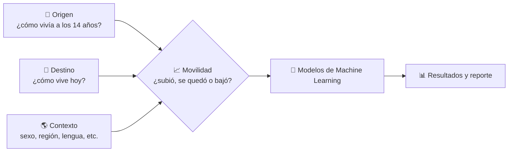
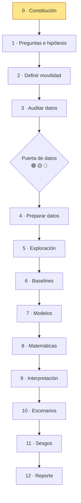

# ¿Qué tan pegajosa es la pobreza?

Proyecto de Machine Learning sobre movilidad social en México.

> ¿En qué medida las condiciones socioeconómicas de origen están asociadas con la posición económica alcanzada en la edad adulta en México, y qué factores individuales, familiares, territoriales y estructurales aumentan o reducen la probabilidad de movilidad social ascendente, permanencia o descenso?

El documento maestro con fases, prompts, bitácoras y reglas metodológicas está en [`roadmap.md`](roadmap.md).

## ¿Cómo funciona el proyecto?



| Documento | Qué contiene |
|---|---|
| [`docs/base_de_datos.md`](docs/base_de_datos.md) | Qué base usaremos y qué debe tener |
| [`docs/variables.md`](docs/variables.md) | Lista de variables por sección |
| [`roadmap.md`](roadmap.md) | Plan completo por fases |

## Avance por fases



## Estructura

- `data/` — `raw` (nunca se edita), `interim`, `processed`, `external`. No se versiona en Git.
- `docs/` — rúbrica, referencias, decisiones y reporte.
- `notebooks/` — numerados, se ejecutan en orden.
- `src/` — código reutilizable (datos, features, modelos, evaluación, visualización).
- `reports/` — figuras, tablas y reporte final generados desde código.
- `models/` — modelos guardados (con versión de datos y parámetros).
- `tests/` — pruebas.

## Reproducir

```bash
python -m venv .venv && source .venv/bin/activate
pip install -r requirements.txt
jupyter notebook
```

## Estado

Fase 0 — Constitución y control del proyecto.
