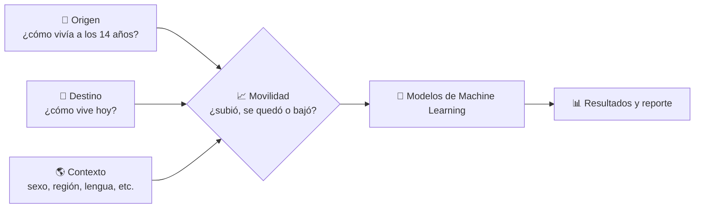
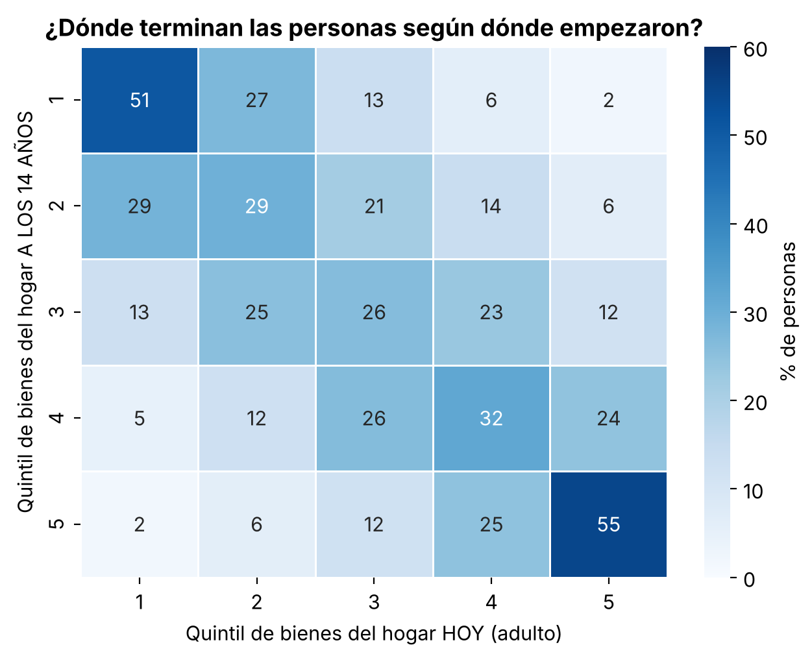
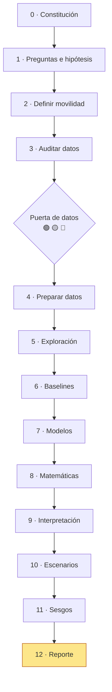

# ¿Qué tan pegajosa es la pobreza?

Proyecto de Machine Learning sobre movilidad social en México.

> ¿En qué medida las condiciones socioeconómicas de origen están asociadas con la posición económica alcanzada en la edad adulta en México, y qué factores individuales, familiares, territoriales y estructurales aumentan o reducen la probabilidad de movilidad social ascendente, permanencia o descenso?

El documento maestro con fases, prompts, bitácoras y reglas metodológicas está en [`roadmap.md`](roadmap.md).

## ¿Cómo funciona el proyecto?



## Resultados principales

> Fuente: ESRU-EMOVI 2023 (17,843 personas de 25 a 64 años, que representan a 60 millones). Todo es **asociación, no causalidad**.



> **Aclaración de lenguaje:** "pobreza" aparece solo en el título. Lo que se mide es la **posición relativa del hogar en la distribución de bienes y servicios** (Q1 = el 20% de hogares con menos bienes de cada generación), no la pobreza oficial de CONEVAL. Las tasas son ponderadas, con IC 95% por conglomerados.

| Hallazgo | Dato |
|---|---|
| 🔒 **La desventaja es pegajosa** | **51%** de quienes crecen en el 20% de hogares con menos bienes siguen ahí de adultos (IC 95%: 46–55%). Solo **2%** llega al 20% con más bienes |
| 🔒 **La ventaja también** | 55% de quienes crecen en el 20% con más bienes siguen ahí (IC 52–58%) |
| 🧭 **La región pesa más que todo** | Siguen en el 20% con menos bienes: **64%** de quienes crecieron en el Sur (IC 59–69) vs **23%** en el Norte (IC 12–37) |
| 🗣️ **Lengua indígena** | **69%** (IC 60–77) vs 47% (IC 42–52). Casi el doble de momios, aun con la misma región y un origen similar (lengua que se habla hoy) |
| 🎓 **La escolaridad propia es la característica más asociada con haber salido** | 56% sigue con primaria o menos vs **18%** con estudios profesionales (IC 8–30). Es mediadora, no causa demostrada |
| 🏘️ **Crecer en un pueblo** | Momios 1.5 veces mayores que en una ciudad, con la misma región, lengua y origen (p = 0.009; se mantiene sin pesos) |
| ➕ **Desventajas acumuladas** | Sur + pueblo + lengua indígena: **82%** sigue (IC 74–88) vs **30%** sin ninguna (IC 22–38) |
| 🤖 **Modelo** | La regresión logística (AUC ≈ 0.70) iguala a random forest y gradient boosting, es la más interpretable y de las más rápidas. Está calibrada por sexo, lengua, región y tono de piel (fuera de muestra) |
| ✅ **Robusto** | Entre 47% y 51% con tres definiciones distintas de riqueza |
| 🗺️ **Contexto estatal (exploratorio)** | Los estados con más pobreza en 2022 (CONEVAL) tienden a mostrar mayor persistencia (r ≈ 0.56), pero la EMOVI no es representativa por estado (n efectivo ≈ 31 por estado) |
| ⚪ **Tono de piel** | Sin brecha significativa con estos datos (IC traslapados); si varía por región es una pregunta abierta |

> 🔎 **Auditoría integral (2026-11-16):** dictamen **APROBADO CON CAMBIOS**. Se **retiró** un hallazgo anterior ("el modelo subestima ≈11 pts la persistencia del tono oscuro"): venía de una sola partición de prueba de 114 personas. Detalle en [`docs/audit/`](docs/audit/Auditoria_Integral_y_Plan_de_Accion_Movilidad_Social_Mexico.md) y en la [trazabilidad de cambios](docs/audit/07_trazabilidad_cambios.md).

### Hipótesis del roadmap (H001–H005)
| # | Hipótesis | Estado |
|---|---|---|
| H001 | El origen se asocia con la posición adulta | ✅ Apoyada provisionalmente |
| H002 | La educación modera la persistencia | ✅ Apoyada provisionalmente (mediadora) |
| H003 | El efecto de la educación varía por región | ⚪ Sin evidencia (p ≈ 0.26) |
| H004 | Movilidad educativa sin movilidad económica equivalente | ✅ Apoyada: 43% de quienes superaron a sus padres sigue en Q1 |
| H005 | Las desventajas combinadas informan más | ✅ Se acumulan (30% → 82%), ⚪ pero sin sinergia |

### Hipótesis del equipo
| # | Hipótesis | Veredicto |
|---|---|---|
| H1 | Más de 40% de quienes nacen en Q1 siguen en Q1 | ✅ Se confirma (51%, IC 46–55) |
| H2 | Crecer en el Sur o en zona rural aumenta la persistencia | ✅ Sur (RM 1.8) · ✅ Pueblo frente a ciudad (RM 1.5, tras corregir la referencia en la auditoría) |
| H3 | La escolaridad de la madre reduce la persistencia | ❌ No se observa dentro de Q1 (casi no hay variación) |
| H4 | Lengua indígena y tono oscuro aumentan la persistencia | ✅ Lengua · ⚪ Tono: sin evidencia significativa |
| H5 | Los modelos complejos no superan a la logística | ✅ Se confirma |

## Notebooks (ejecutados, se pueden ver directo en GitHub)

| # | Notebook | Fase del roadmap |
|---|---|---|
| 00 | [Contexto, preguntas e hipótesis](notebooks/00_context_and_scope.ipynb) | 0, 1, 2 |
| 01 | [Auditoría de datos](notebooks/01_data_audit.ipynb) | 3 |
| 02 | [Preparación e índices](notebooks/02_data_preparation.ipynb) | 4 |
| 03 | [Análisis exploratorio](notebooks/03_eda.ipynb) | 5 |
| 04 | [Baselines](notebooks/04_baselines.ipynb) | 6 |
| 05 | [Modelos y comparación](notebooks/05_modeling.ipynb) | 7 |
| 06 | [Interpretación](notebooks/06_interpretability.ipynb) | 8, 9 |
| 07 | [Escenarios](notebooks/07_scenarios.ipynb) | 10 |
| 08 | [Validación, sesgos y robustez](notebooks/08_final_validation.ipynb) | 11, 13 |

Más documentos: [auditoría](docs/audit/Auditoria_Integral_y_Plan_de_Accion_Movilidad_Social_Mexico.md) · [rúbricas](docs/rubric/) · [decisiones](docs/decisions/bitacora_decisiones.md) · [experimentos](docs/registro_experimentos.md) · [fundamentos matemáticos](docs/report/fundamentos_matematicos.md) · [auditoría final](docs/report/auditoria_final.md) · [referencias](docs/report/referencias.md)

| Documento | Qué contiene |
|---|---|
| [`docs/base_de_datos.md`](docs/base_de_datos.md) | Qué base usaremos y qué debe tener |
| [`docs/variables.md`](docs/variables.md) | Lista de variables por sección |
| [`roadmap.md`](roadmap.md) | Plan completo por fases |

## Avance por fases



## Estructura

- `data/` — `raw` (nunca se edita), `interim`, `processed`, `external`. No se versiona en Git.
- `docs/` — rúbrica, referencias, decisiones y reporte.
- `notebooks/` — numerados, se ejecutan en orden.
- `src/` — código reutilizable (datos, features, modelos, evaluación, visualización).
- `reports/` — figuras, tablas y reporte final generados desde código.
- `models/` — modelos guardados (con versión de datos y parámetros).
- `tests/` — pruebas.

## Reproducir

```bash
python -m venv .venv && source .venv/bin/activate
pip install -r requirements.txt
unzip data/esru_emovi.zip -d data/raw/esru_emovi   # ver docs/base_de_datos.md para CONEVAL y ENOE
jupyter notebook                                    # ejecutar 01 → 08 en orden
```

## Estado

Fases 0 a 11: **APROBADAS CON CAMBIOS** tras la auditoría integral y la aplicación de las correcciones (sección 6.1 de `roadmap.md`). Siguiente: **Fase 12 — cartel (90×120 cm) y reporte PDF**.
